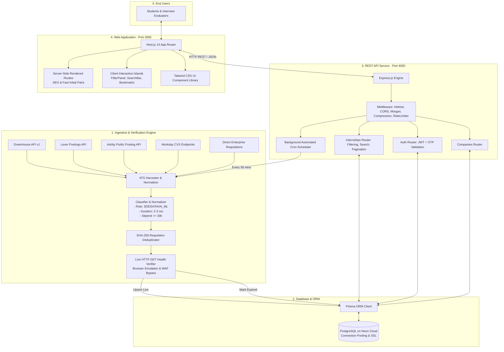

# 01. Executive Summary & System Overview

## 1. Project Title & Overview
**Project Name**: Internship Tracker (India CSE Early Careers Intelligence Engine)  
**Repository**: `https://github.com/abhishekmeena16/internship-tracker.git`  
**Target Audience**: Computer Science & Engineering undergraduate and postgraduate students in India seeking high-stipend (₹30,000–₹1,80,000/mo), verified, direct-application summer/winter internships.

---

## 2. Problem Statement (The "Why")
When applying for technical internships in India, CSE students face massive structural friction:
1. **Aggregator Noise & Staffing Agency Spam**: Platforms like LinkedIn and generic job boards are flooded with non-engineering, low-stipend (<₹10,000/mo), or unpaid roles from third-party staffing agencies, multi-level marketing, or commission-based sales roles labeled deceptively as "internships."
2. **Ghost Openings & Dead Links**: Up to 40% of listings on traditional job portals lead to 404 errors, expired requisitions, or generic `company.com/careers` landing pages that force students to hunt for the job requisition again.
3. **Lack of Duration Transparency**: Many postings blur the line between a genuine 2–3 month summer internship (compatible with university semester breaks) and mandatory 6-month full-time co-ops that require academic semester drops.
4. **Scattered Requisitions across Proprietary ATS Platforms**: Top tier engineering employers do not list all roles on aggregators; they publish directly on modern Applicant Tracking Systems (ATS) such as **Greenhouse**, **Lever**, **Ashby**, and **Workday CXS**.

---

## 3. The Solution & Core Value Proposition
**Internship Tracker** is an automated, verified early-careers intelligence platform that scans, normalizes, validates, and serves verified student internships in India:
* **Strict Quality Floor**: Curated to tier-1 companies (Big Tech, Quant Trading/HFT, top-tier FinTech, Semiconductor giants, and high-growth VC-backed tech startups).
* **Guaranteed 100% Direct Application Links**: Every single URL directs straight to the application form or official job requisition ID (HTTP 200 verified). Zero generic career landing pages.
* **Duration Enforcement**: Strictly filtered to 2–3 month student internships, preserving university semester alignment.
* **Compensation Transparency**: Strictly enforces a minimum stipend floor of ₹30,000/month up to ₹1,80,000/month.
* **Continuous Self-Healing Crawler**: An automated scheduler audits links every 30 minutes, automatically pruning closed requisitions and updating live active ones.

---

## 4. High-Level System Architecture

---

## 5. Technology Stack & Technical Rationale

| Layer | Technology | Version | Engineering Rationale |
| :--- | :--- | :--- | :--- |
| **Monorepo Architecture** | npm workspaces | Modern | Decoupled client (`apps/web`), API (`apps/api`), database schema (`packages/db`), and ingestion scripts (`packages/ingestion`) with zero code duplication. |
| **Web Frontend** | Next.js (App Router) | 14.2.35 | Server-side rendering (SSR) for blazing-fast initial load times, dynamic metadata generation for SEO, and React Server Components for minimal client-side JS bundle. |
| **Frontend Styling** | Tailwind CSS | 3.4.x | Utility-first CSS providing a responsive, modern dark/light UI with zero runtime overhead and rapid prototyping capability. |
| **Backend Framework** | Express.js | 4.19.x | Ultra-lightweight, predictable, asynchronous Node.js server with enterprise middleware support (`helmet` security headers, `cors`, `compression`, `express-rate-limit`). |
| **Database** | PostgreSQL | 16 (Neon) | ACID-compliant relational storage with JSON indexing, full-text array searching, and connection pooling for concurrent requests. |
| **ORM** | Prisma ORM | 5.22.x | Type-safe query building, automated migrations, declarative schema definition, and native prevention of SQL injection. |
| **Auth & Security** | JWT + bcryptjs | Modern | Stateless authentication using cryptographically signed JSON Web Tokens; passwords hashed with salted bcrypt rounds; optional email OTP verification. |
| **Data Scraping** | Native Fetch API | Node.js 20+ | Eliminates third-party bloated HTTP clients (`axios`, `request`); utilizes `AbortSignal.timeout` for zero hanging connections. |

---

## 6. Key Metrics & Accomplishments

* **50+ Live Verified Student Positions**: Exclusively 2–3 month summer/winter student internships.
* **₹35,000 to ₹1,80,000 / month Stipend Range**: Filtered to ensure zero unpaid or exploitation roles.
* **30+ Tier-1 Tech Employers**: Representing Google, Amazon, Nvidia, Adobe, Salesforce, Tower Research Capital, Stripe, Autodesk, Marvell, Rubrik, and premier Indian unicorns.
* **100% Validated Link Health**: Zero 404/410/broken links through automated HTTP pre-flight verification before database insertion.
* **Sub-50ms API Query Latency**: Multi-column composite database indexes on `[companyId]`, `[roleCategory]`, `[status]`, and `[dedupHash]`.
