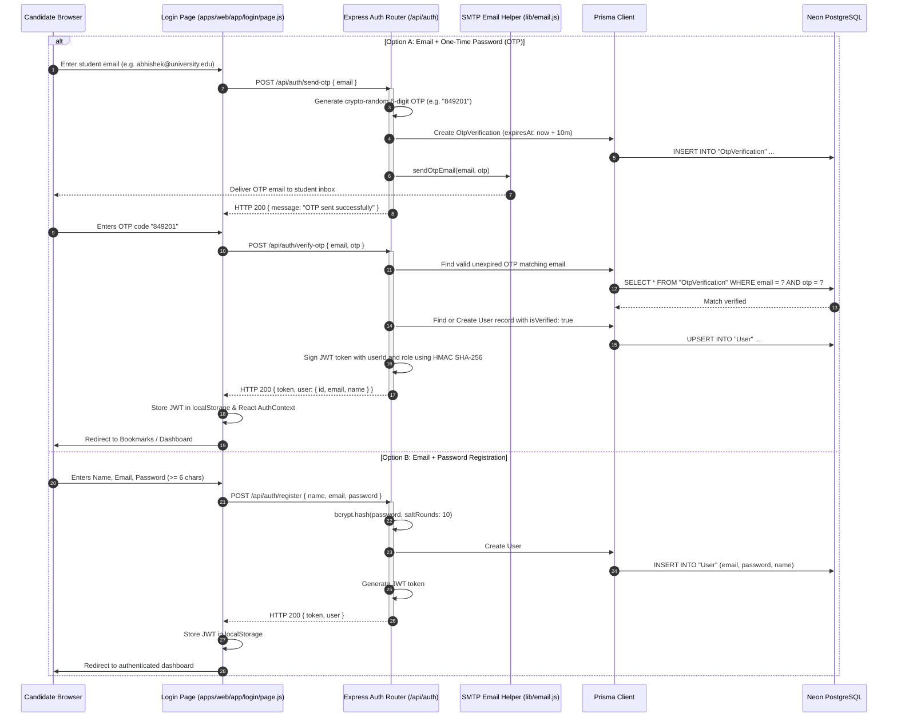
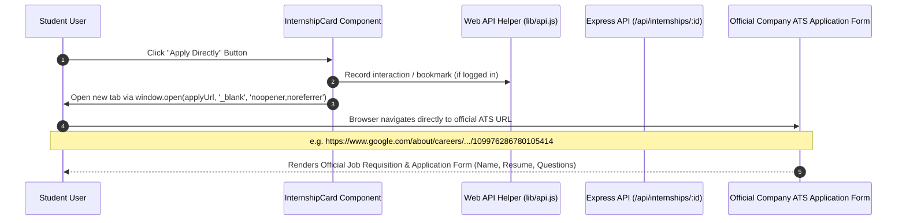

# 03. Component Interactions & Sequence Flows

## 1. System Interaction Overview
This document outlines the detailed sequence flows and component interactions across the Internship Tracker application, from client-side UI actions to backend routing, database queries, and external ATS network calls.

---

## 2. Sequence Diagram 1: Automated Ingestion & Live Link Verification Flow

This sequence demonstrates how the system autonomously discovers new internships, verifies them over HTTP, deduplicates against existing records, and updates PostgreSQL.

```mermaid
sequenceDiagram
    autonumber
    participant Cron as Scheduler (node-cron / 30m)
    participant Sync as Ingestion Engine (sync-all-live.js)
    participant ExtATS as External ATS (Greenhouse/Lever/Ashby/Workday)
    participant Verifier as HTTP GET Link Verifier
    participant Prisma as Prisma Client
    participant DB as Neon PostgreSQL

    Cron->>Sync: triggerLiveSync("CRON_TICK")
    activate Sync
    Sync->>Sync: Check isRunning lock (Prevent race conditions)
    Sync->>ExtATS: Parallel fetch job feeds (Limit 20 per chunk)
    activate ExtATS
    ExtATS-->>Sync: Return JSON raw job listings
    deactivate ExtATS

    loop For Each Discovered Job Listing
        Sync->>Sync: Normalization: Check India Location + Intern Title
        Sync->>Sync: Role Classification (SDE / DATA / AI_ML / OTHER)
        Sync->>Sync: Duration Check (Keep strictly 2-3 months)
        Sync->>Sync: Compensation Check (Stipend >= 30,000 INR)
        Sync->>Sync: Generate Requisition Key & SHA-256 dedupHash
    end

    Sync->>Verifier: Validate applyUrl list (Batch size 10)
    activate Verifier
    loop For Each URL
        Verifier->>ExtATS: HTTP GET with Browser Headers & 8s Timeout
        ExtATS-->>Verifier: Return HTTP Status (200 / 404 / 410)
    end
    Verifier-->>Sync: Return Verified Active URLs (Discard Dead)
    deactivate Verifier

    Sync->>Prisma: Batch Upsert Live Verified Positions
    activate Prisma
    Prisma->>DB: INSERT ... ON CONFLICT (dedupHash) DO UPDATE
    DB-->>Prisma: Confirm upserted IDs
    Prisma-->>Sync: Complete
    deactivate Prisma

    Sync->>Prisma: Query previously OPEN jobs not in current batch
    activate Prisma
    Prisma->>DB: SELECT id, applyUrl FROM "Internship" WHERE status = 'OPEN'
    DB-->>Prisma: Return stale active candidates
    loop For Each Stale Candidate
        Sync->>Verifier: HTTP GET Check
        alt Status is 404 / Expired
            Sync->>Prisma: UPDATE "Internship" SET status = 'CLOSED'
            Prisma->>DB: Set status = 'CLOSED'
        end
    end
    deactivate Prisma

    Sync->>Cron: Complete. Release isRunning lock.
    deactivate Sync
```



---

## 3. Sequence Diagram 2: User Search, Multi-Facet Filtering & Pagination Flow

This sequence demonstrates how a student interacts with the web application to search and filter internships.

```mermaid
sequenceDiagram
    autonumber
    participant User as Student Browser
    participant NextPage as Next.js Page (apps/web/app/page.js)
    participant FilterUI as FilterPanel Component
    participant SearchUI as SearchBar Component
    participant API as Express API (/api/internships)
    participant Val as Middleware (validate.js)
    participant Prisma as Prisma Client
    participant DB as Neon PostgreSQL

    User->>SearchUI: Type query "Amazon AI" + Press Enter / Click Search
    SearchUI->>NextPage: Trigger onSearch("Amazon AI")
    User->>FilterUI: Select Role "AI_ML" + Stipend "> 50k"
    FilterUI->>NextPage: Trigger onFilterChange({ role: 'AI_ML', minStipend: 50000 })
    
    NextPage->>NextPage: Synchronize URL SearchParams (?q=Amazon+AI&role=AI_ML&minStipend=50000)
    NextPage->>API: GET /api/internships?q=Amazon+AI&role=AI_ML&minStipend=50000&page=1&limit=10
    activate API
    
    API->>Val: validatePagination(req.query)
    Val-->>API: { page: 1, limit: 10, skip: 0 }
    
    API->>API: Construct Prisma Where Clause:\n- status: 'OPEN'\n- roleCategory: 'AI_ML'\n- stipendMin: { gte: 50000 }\n- OR search: title, description, company, skills
    
    API->>Prisma: Promise.all([ findMany({ where, skip, take }), count({ where }) ])
    activate Prisma
    Prisma->>DB: SELECT * FROM "Internship" WHERE ... LIMIT 10 OFFSET 0;\nSELECT COUNT(*) FROM "Internship" WHERE ...;
    DB-->>Prisma: Return records & total count
    Prisma-->>API: Query Result
    deactivate Prisma
    
    API-->>NextPage: HTTP 200 JSON: { data: [...10 items], pagination: { page: 1, limit: 10, total: 34, totalPages: 4 } }
    deactivate API
    
    NextPage->>NextPage: Update React State: internships, totalPages, isLoading: false
    NextPage->>User: Re-render Internship Grid with 10 Responsive InternshipCards
```

---

## 4. Sequence Diagram 3: User Authentication & JWT Session Flow

This sequence demonstrates the passwordless and password-based authentication system with OTP verification.



---

## 5. Sequence Diagram 4: Direct Application Redirection & Tracking

This sequence illustrates what occurs when a student clicks **"Apply Directly"**:



---

## 6. Frontend Component Architecture & Tree

The frontend is structured in the Next.js 14 App Router pattern:

```
apps/web/
├── app/
│   ├── layout.js                 # Global HTML Root, Meta Tags, Navbar, Footer, Providers
│   ├── providers.js              # Theme Provider, Auth Context, TanStack Query Client
│   ├── page.js                   # Main Discovery Dashboard (Hero, Stats, Feed, Pagination)
│   ├── browse/page.js            # Alternate clean browsing view
│   ├── companies/
│   │   ├── page.js               # Alphabetical & Sector Grid of 210+ Tracked Companies
│   │   └── [slug]/page.js        # Company Dossier: HQ, Sector, Active Openings List
│   ├── internships/
│   │   └── [id]/page.js          # Deep Dive Role Spec: Skills, Timeline, Markdown Summary
│   ├── saved/page.js             # User's Bookmarked Internships (Requires Auth)
│   └── login/page.js             # Dual-mode Auth: OTP verification + Password login
│
└── components/
    ├── Navbar.js                 # Navigation bar, mobile drawer, auth status pill
    ├── FilterPanel.js            # Multi-select filters: Role, Location, Stipend, Duration, Degree
    ├── SearchBar.js              # Debounced search input + instant submission handler
    ├── InternshipCard.js         # Core listing card: stipend badge, duration, company logo, apply CTA
    ├── InternshipDetailClient.js # Rich details modal/drawer with full spec rendering
    ├── CompanyInternshipsList.js # Embeddable list of openings on company detail page
    ├── Badge.js                  # Standardized color-coded tags (SDE=Blue, AI=Purple, Data=Green)
    ├── Skeleton.js               # Animated placeholder skeletons for loading states
    ├── Pagination.js             # Responsive page navigation with ellipsis handling
    └── EmptyState.js             # Friendly UI state when no filters match
```

---

## 7. Backend Middleware Pipeline

Every HTTP request entering Express is processed in a sequential pipeline before reaching business logic:

1. **`cors()`**: Whitelists frontend domain (`localhost:3000` or production domain) while enabling credential sharing.
2. **`helmet()`**: Injects HTTP security headers (`X-Content-Type-Options: nosniff`, `X-Frame-Options: DENY`, `Strict-Transport-Security`).
3. **`morgan('dev')`**: Real-time HTTP request logging with method, path, response status, and millisecond latency.
4. **`compression()`**: Gzip/Brotli response compression, reducing payload size by up to 70% for large JSON lists.
5. **`express.json()`**: Parses incoming JSON request bodies with payload size safety caps.
6. **`authLimiter`**: Enforces IP-based rate limiting (100 requests per 15 minutes) on sensitive authentication endpoints.
7. **`requireAuth`**: Validates `Authorization: Bearer <token>`, decodes JWT claims, and attaches `req.user`.
8. **`errorHandler`**: Catch-all global error handling middleware that captures unexpected exceptions, formats standard JSON error payloads, and logs stack traces.
