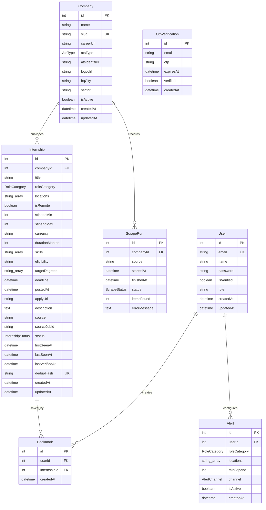

# 04. Database Schema & Data Models

## 1. Relational Database Architecture
The **Internship Tracker** data layer is powered by **PostgreSQL** (hosted serverless on Neon with AWS connection pooling and SSL encryption) managed through **Prisma ORM**.

The schema is normalized to 3NF (Third Normal Form) across enterprise profiles, role requisitions, user authentication, and alert subscriptions.

---

## 2. Entity-Relationship Diagram (ERD)



---

## 3. Data Dictionary & Model Specifications

### A. Model `Company`
Stores company identities, corporate headquarters, business sector, and ATS tracking metadata.

| Column | Type | Constraints | Description |
| :--- | :--- | :--- | :--- |
| `id` | `Int` | Primary Key, Autoincrement | Unique company identifier. |
| `name` | `String` | Required | Official company name (e.g. "Google", "Amazon"). |
| `slug` | `String` | Unique, Required | URL-safe slug (e.g. "google", "tower-research-capital"). |
| `careerUrl`| `String` | Required | Company official top-level careers landing page. |
| `atsType` | `AtsType` | Enum, Required | ATS platform type (`GREENHOUSE`, `LEVER`, `ASHBY`, `CUSTOM`). |
| `atsIdentifier`| `String` | Required | Slug identifier used in the company's ATS board URL. |
| `logoUrl` | `String?` | Optional | CDN URL to high-resolution vector or PNG corporate logo. |
| `hqCity` | `String?` | Optional | Indian corporate hub (e.g. "Bengaluru", "Gurugram"). |
| `sector` | `String?` | Optional | Industry classification (e.g. "Big Tech", "Quant / FinTech"). |
| `isActive` | `Boolean` | Default: `true` | Indicates whether the automated scraper monitors this company. |

---

### B. Model `Internship`
The primary table storing verified internship requisitions.

| Column | Type | Constraints | Description |
| :--- | :--- | :--- | :--- |
| `id` | `Int` | Primary Key, Autoincrement | Unique internship ID. |
| `companyId` | `Int` | Foreign Key -> `Company.id` | Reference to parent company. |
| `title` | `String` | Required | Official job title (e.g. "Software Development Engineer Intern"). |
| `roleCategory`| `RoleCategory`| Enum, Indexed | Technical category: `SDE`, `DATA`, `AI_ML`, or `OTHER`. |
| `locations` | `String[]` | Array | Locations where the role is offered (e.g. `["Bengaluru", "India"]`). |
| `isRemote` | `Boolean` | Default: `false` | True if explicitly designated as a remote/WFA position. |
| `stipendMin` | `Int?` | Optional | Minimum monthly stipend in INR (e.g. `110000`). |
| `stipendMax` | `Int?` | Optional | Maximum monthly stipend in INR (e.g. `130000`). |
| `currency` | `String` | Default: `"INR"` | ISO currency code. |
| `durationMonths`| `Int?` | Optional | Internship duration (enforced strictly to 2 or 3 months). |
| `skills` | `String[]` | Array | Required skills/technologies (e.g. `["PyTorch", "C++", "CUDA"]`). |
| `eligibility` | `String?` | Optional | Text explanation of eligible graduation batches and degrees. |
| `targetDegrees`| `String[]` | Array | Eligible degrees (e.g. `["BTECH", "MTECH", "MCA"]`). |
| `deadline` | `DateTime?`| Optional | Application deadline timestamp. |
| `postedAt` | `DateTime?`| Optional | Original date/time requisition was published by employer. |
| `applyUrl` | `String` | Required | **100% verified direct link** to the application form. |
| `description` | `Text` | Required | Full text job description, requirements, and role expectations. |
| `source` | `String` | Required | Origin ATS or crawler tag (`GREENHOUSE`, `LEVER`, `ASHBY`, etc.). |
| `sourceJobId` | `String` | Required | Unique requisition ID from employer's ATS (e.g. `10541345`). |
| `status` | `InternshipStatus`| Default: `OPEN`, Indexed | Listing state: `OPEN` or `CLOSED`. |
| `firstSeenAt` | `DateTime` | Default: `now()` | Timestamp when the role was first discovered by scraper. |
| `lastSeenAt` | `DateTime` | Default: `now()` | Timestamp when the scraper last confirmed existence at source. |
| `lastVerifiedAt`| `DateTime` | Default: `now()` | Timestamp of the most recent successful HTTP GET 200 health check. |
| `dedupHash` | `String` | Unique, Indexed | SHA-256 hash preventing duplicate listings. |

---

### C. Model `User`
Manages authenticated candidate accounts, saved bookmarks, and custom alerts.

| Column | Type | Constraints | Description |
| :--- | :--- | :--- | :--- |
| `id` | `Int` | Primary Key, Autoincrement | Unique user account ID. |
| `email` | `String` | Unique, Required | Verified student email address. |
| `name` | `String?` | Optional | Candidate full name. |
| `password` | `String?` | Optional | Salted bcrypt hash (null if user authenticated solely via OTP). |
| `isVerified`| `Boolean` | Default: `false` | Email verification flag. |
| `role` | `String` | Default: `"USER"` | Access control level (`USER` or `ADMIN`). |

---

### D. Model `OtpVerification`
Stores cryptographically random one-time passwords for passwordless email verification.

| Column | Type | Constraints | Description |
| :--- | :--- | :--- | :--- |
| `id` | `Int` | Primary Key, Autoincrement | Unique OTP record ID. |
| `email` | `String` | Indexed | Target recipient email address. |
| `otp` | `String` | Required | 6-digit numeric OTP string. |
| `expiresAt` | `DateTime` | Required | Expiration timestamp (strictly 10 minutes from creation). |
| `verified` | `Boolean` | Default: `false` | True once successfully exchanged for a JWT session. |

---

### E. Model `Bookmark`
Stores saved internships for user candidate dashboards. Enforces a composite unique constraint `@@unique([userId, internshipId])` to prevent duplicate bookmarks.

---

## 4. Database Indexing & Performance Tuning

High-concurrency query performance is guaranteed through composite indexes defined in `schema.prisma`:

```prisma
model Internship {
  ...
  @@index([companyId])
  @@index([roleCategory])
  @@index([status])
  @@index([dedupHash])
}
```

### Why These Indexes Matter (Interview Talking Points):
1. **Filtering by Status (`status`)**:
   95% of queries filter for `WHERE status = 'OPEN'`. An index on `status` enables the PostgreSQL query planner to perform an **Index Scan** instead of an expensive **Sequential Table Scan** across thousands of closed/historical records.
2. **Composite Filtering (`companyId`, `roleCategory`)**:
   Enables sub-10ms lookups when students filter by category (e.g. `WHERE roleCategory = 'AI_ML' AND status = 'OPEN'`).
3. **Unique Hash Index (`dedupHash`)**:
   Underneath the hood, PostgreSQL maintains a B-Tree index on `dedupHash`. Ingestion upserts execute in `O(log N)` time, instantly detecting whether a scraped job is a duplicate without reading the entire table.
